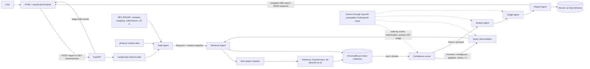
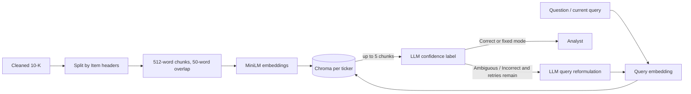

# Financial Research Analyst

<div align="center">

**An educational financial research application that investigates a company's latest SEC 10-K alongside market data.**

The app helps people understand public companies using SEC annual reports and market data. Search by company name, choose a plain-language question, and get an evidence-linked explanation. Technical retrieval and retry controls are hidden under Advanced settings.

[Architecture](#architecture) · [Retrieval](#retrieval-pipeline) · [Setup](#local-setup) · [API](#api)


</div>

## Contents

- [Overview](#overview)
- [Architecture](#architecture)
- [The five agents](#the-five-agents)
- [Retrieval pipeline](#retrieval-pipeline)
- [Judge and evaluation](#judge-and-evaluation)
- [API](#api)
- [Technology stack](#technology-stack)
- [Repository layout](#repository-layout)
- [Local setup](#local-setup)
- [Configuration](#configuration)
- [Performance and evaluation](#performance-and-evaluation)
- [Tests](#tests)
- [Screenshots](#screenshots)
- [Limitations](#limitations-and-trade-offs)
- [Engineering decisions](#engineering-decisions)
- [Roadmap](#future-work)
- [Responsible use](#responsible-use)
- [References](#references)

## Overview

Long annual filings are difficult to search manually. This project retrieves passages from a company's latest 10-K and turns them into a plain-language answer with supporting strengths, risks, source links, and optional market context.

**Coverage:** The company search uses SEC records and this app is designed for U.S. companies with SEC 10-K filings. Companies listed only on India's NSE/BSE or other foreign exchanges are not supported yet.

| Capability | Implementation |
|---|---|
| Filing research | Fetches the latest 10-K listed in SEC submissions data, preserves flattened table rows, and tracks accession, filing date, report date, and SEC URL. |
| Market snapshot | Gets price, 52-week range, P/E, market capitalization, revenue, and EPS through `yfinance`; this data is separate from filing evidence. |
| Filing retrieval | Splits text into Item sections, embeds overlapping chunks, and searches accession-scoped Chroma collections using dense, local BM25, or reciprocal-rank-fused hybrid search. |
| Adaptive retrieval | An LLM labels retrieved evidence Correct, Ambiguous, or Incorrect; adaptive mode can reformulate and retry up to two times. |
| Analysis and review | Analyst writes a plain-language answer, supported strengths and risks, a neutral takeaway, and section citations. A separate automated Judge check remains an engineering signal. |
| User interface | Company-name autocomplete, plain-language question choices, accessible advanced settings, and SSE progress. |
| Report history | SQLAlchemy persists company names and reports in SQLite by default. Automated Judge scores are not shown as investment ratings. |

The system is an engineering and learning project, not a production financial research service. “Grounded” means evaluated against retrieved filing chunks; it does not establish factual correctness or full filing coverage.

## Recent engineering improvements

- Added local Okapi BM25 and hybrid dense + BM25 search with reciprocal rank fusion (RRF), selectable in the UI and API.
- Fixed the analyst prompt so it receives the actual research question.
- Made retrieval strategy and Judge mode request-scoped; fixed mode skips the extra confidence LLM call.
- Keyed filing caches and Chroma indexes by SEC accession number, and added a startup migration for legacy per-ticker indexes.
- Preserved SEC table rows during text cleaning and added request timeouts to SEC downloads.
- Added filing/market timestamps, SEC filing links, readable evidence excerpts, and data warnings to reports.
- Switched optional RAGAS evaluation to the configured Gemini client and removed the generated-answer-as-reference proxy.
- Added an offline section-retrieval benchmark (24 cases, Recall@5 and MRR) and unit coverage for BM25/RRF.
- Reworked the default UI around company names and plain-language questions, with retrieval internals under Advanced settings.
- Reframed the report around a direct answer, key strengths, risks, filing sources, and explicit limits; removed the prominent Judge score and investment-oriented framing.
- Enlarged the topic choices and styled Advanced settings as a clear, clickable panel; added an up-front note about U.S. filing coverage.
- Added an opt-in, per-run LangSmith trace checkbox under Advanced settings, with a direct trace link when available and a disclosure of what data is sent.

The benchmark's labels identify expected SEC Items; they are not manually reviewed passage relevance judgments. Treat its scores as a small retrieval smoke test, not a general quality claim.

## Architecture



The graph state carries the ticker, original and current question, market and filing data, retrieved chunks, confidence label and retry count, analyst draft, Judge result, and final report. The five named agents are graph nodes; the confidence scorer is an additional node between retrieval and analysis. Fixed mode bypasses confidence scoring; adaptive mode uses it to decide whether to retry.

### LangGraph execution


The initial retrieval counts as attempt one. `retry_count` starts at zero and permits at most two additional retrieval passes. Once retry capacity is exhausted, the graph proceeds to the Analyst with the latest retrieved chunks—even if the confidence label remains weak. There is no alternate terminal path for a low score.

## The five agents

| Agent | Responsibility | Input | Output and downstream use |
|---|---|---|---|
| Data | Obtain the latest 10-K, filing metadata, and market snapshot. Market values use a 24-hour cache; filing content/index keys include the accession number. | Ticker | Filing text, accession/date/URL metadata, market values, fetch time, and data warnings. |
| Retriever | Create a filing-specific Chroma collection when empty, then search the current question with dense, BM25, or hybrid RRF retrieval. | Filing text, ticker, current query, selected search mode | Up to five evidence chunks with section, filing metadata, and retrieval scores. |
| Analyst | Ask Gemini for a validated structured analysis constrained by financial data and retrieved chunks. Empty retrieval produces an insufficient-data summary without an LLM call. | `fundamentals`, retrieved chunks | `report_draft`: bull points, bear points, neutral summary, citations. |
| Judge | Score draft grounding, completeness, clarity, and overall quality against retrieved chunks. | Draft, retrieved chunks | `judge_score`, including flagged issues; available to API clients for engineering analysis. It does not approve, reject, or revise the report. |
| Report | Assemble market snapshot, bull/bear cases, summary, and retrieved sources into Markdown/HTML-like report text. | Market data, draft, chunks | `final_report`; API saves it to history. |

LangGraph passes partial state updates between nodes and routes conditionally after the confidence scorer. The agents are functions orchestrated in one graph, not independent services.

## Retrieval pipeline

1. **Acquire:** Data Agent maps an alphabetic ticker to a CIK using SEC's ticker mapping (with an XOM override), reads the submissions record, and fetches the latest listed `10-K` primary document with accession/date/URL metadata. Market data comes separately from `yfinance` and includes a fetch timestamp.
2. **Clean:** BeautifulSoup removes scripts/styles and flattens table rows into pipe-separated text to retain financial statement values. SEC requests use a 30-second timeout.
3. **Chunk and embed:** Text is split on headers matching `Item <number>[optional letter].`. Each section is chunked by 512 words with 50-word overlap. If fewer than ten chunks result, fixed-size chunks labeled `Item General` are used. `all-MiniLM-L6-v2` embeds each chunk.
4. **Index:** ChromaDB stores embeddings, chunk text, sections, and filing dates in collections keyed by ticker and SEC accession. Existing legacy per-ticker indexes are copied into a `legacy` namespace at startup and remain on disk.
5. **Search:** `dense` ranks by MiniLM embeddings, `bm25` uses local Okapi BM25 lexical scores, and `hybrid` fuses the two ranked lists with reciprocal rank fusion (RRF). The UI and API default to hybrid.
6. **Score and retry:** Adaptive mode uses the Gemini scorer to decide whether to reformulate and retry (up to two retries). Fixed mode skips the confidence call and performs one retrieval pass.
7. **Analyze:** The latest retrieved chunks go to the Analyst, which returns structured claims and section names. They are not guaranteed to cover all relevant filing evidence.

| Mode | Behavior | Use case |
|---|---|---|
| `fixed` | One top-five retrieval; confidence scoring executes but never triggers another pass. | Predictable baseline and comparison runs. |
| `adaptive` | Up to two query-reformulation retries when the scorer returns Incorrect or Ambiguous. | Experimenting with retrieval recovery when the first result set appears insufficient. |



Hybrid retrieval currently runs BM25 over the filing's local Chroma documents, so its lexical pass is simple and CPU-based. RRF scores are rankings, not calibrated relevance probabilities. The adaptive sufficiency label remains a model judgment.

## Judge and evaluation

The Judge receives only the structured Analyst draft and retrieved filing chunks. It asks for 0–10 grounding, completeness, clarity, and overall scores plus `flagged_issues`. Pydantic validates the API Judge response. If API evaluation fails, the score is set to `null`; the workflow continues to report generation. The normal UI hides this score in an optional “Automated report quality checks” disclosure and explains that it is not an investment rating. API clients and saved history can still inspect it.

| Mode | Implementation | Requirements and status |
|---|---|---|
| `api` | Gemini via the shared OpenAI-compatible `ChatOpenAI` client; structured JSON parsing/validation. | Requires `GEMINI_API_KEY`; default mode. |
| `finetuned` | Loads the local adapter with Unsloth, 4-bit loading, 6,144-token context, and CUDA generation. | Needs the Unsloth/model stack and CUDA GPU. `unsloth` is not in `requirements.txt`. A local adapter directory is present, but the normal application path has not been verified as a supported CPU mode. |

The request's `judge_mode` selects the evaluator. Gemini API is the supported default. A request for the fine-tuned evaluator returns HTTP 422 with a setup message because that path requires the optional CUDA/Unsloth dependencies and adapter.

Scores are model judgments, not objective correctness metrics or investment suitability checks. The Judge cannot assess evidence that was not retrieved, and a market-data figure can be flagged as ungrounded because only filing chunks are supplied. Existing evaluation notes report score variation between runs and weak-to-moderate API/fine-tuned agreement; those measurements are experiments, not guarantees.

## API

The FastAPI app serves the frontend at `/` and exposes these routes:

| Method | Endpoint | Description |
|---|---|---|
| `POST` | `/report` | Run graph synchronously with a selected SEC company name or ticker, persist result. |
| `GET` | `/report/stream` | Stream graph progress and final result as SSE; accepts selected company name or ticker. |
| `GET` | `/reports` | Return up to 20 reports, newest first. |
| `GET` | `/reports/{report_id}` | Return one persisted report or 404. |
| `GET` | `/companies/search?q=...` | Search SEC company names and ticker symbols for autocomplete. |
| `GET` | `/health` | Check database; returns 200 with `{"status":"ok","database":true}` or 503 when unavailable. |

The browser searches SEC's company directory by name and submits the selected company name plus its ticker. It provides prompts for company overview, products/customers, strengths/risks, or financial performance, plus a custom question field. Ticker-only requests remain supported for API clients; when a company name is supplied it must match the SEC company directory. Search accepts `dense`, `bm25`, or `hybrid`, retrieval strategy accepts `fixed` or `adaptive`, and `langsmith_tracing` is an optional Boolean that enables tracing for that request only. The browser defaults to hybrid plus fixed while keeping technical controls in Advanced settings. Schema errors return 422. Synchronous generation maps upstream timeouts to 504, provider/runtime errors to 502, and other errors to 500. Streaming failures are sent as an SSE `error` event.

`/report` request:

```bash
curl -X POST http://localhost:8000/report \
  -H 'Content-Type: application/json' \
  -d '{"company_name":"Apple Inc.","ticker":"AAPL","question":"What are the main growth drivers and risks?","judge_mode":"api","search_mode":"hybrid","retrieval_mode":"fixed"}'
```

The JSON result includes company/ticker, question, final report, market snapshot, filing metadata, market fetch time, data warnings, and LangSmith tracing status. When available, an enabled trace includes a direct LangSmith URL. It does not return raw filing text. The automated Judge score remains available through API responses for engineering use but is not presented as an investment recommendation in the normal UI.

Streaming request (SSE uses GET query parameters):

```bash
curl -N 'http://localhost:8000/report/stream?ticker=AAPL&question=What%20are%20the%20main%20growth%20drivers%20and%20risks%3F&judge_mode=api&search_mode=hybrid&retrieval_mode=fixed'
```

| Event | Payload |
|---|---|
| `stage` | JSON with a `stage` value (initially `data`, then a graph node name) and a `message`; emitted initially and as nodes complete. |
| `complete` | Same UI result fields as `/report`, after persistence. |
| `error` | `{ "message": "An error occurred while generating the research report. Please try again." }`. |

The browser uses `EventSource` for this streaming endpoint. The frontend is mounted by FastAPI, so opening `http://localhost:8000/` is the simplest supported local path.

## Technology stack

| Category | Technology | Role |
|---|---|---|
| Language and validation | Python 3.12, Pydantic 2 | Application, schemas, and structured model output validation. |
| Orchestration | LangGraph, LangChain | Stateful graph and LLM integration. |
| LLM | Gemini API via `langchain-openai` `ChatOpenAI` compatibility endpoint | Query reformulation, confidence scoring, analysis, and API Judge. |
| Embeddings | Sentence Transformers `all-MiniLM-L6-v2` | Local chunk and query embeddings. |
| Vector store | ChromaDB persistent client | Per-ticker embedding index and nearest-neighbor search. |
| Data sources | SEC EDGAR, `yfinance` | 10-K filing text and separate market/fundamental data. |
| Backend and streaming | FastAPI, Uvicorn, SSE | HTTP endpoints, event stream, static frontend serving. |
| Frontend | HTML, CSS, JavaScript, Marked | Research form, progress, report display, history. |
| Persistence | SQLAlchemy, SQLite by default | Saved reports and Judge scores. |
| Evaluation | pytest, RAGAS, datasets, Matplotlib | Unit/integration checks and offline research/evaluation scripts. |
| Optional observability | LangSmith tracing variables | Optional LangChain tracing when configured. |
| Optional Judge | Unsloth adapter inference | Fine-tuned Judge path; extra GPU/model dependencies are not in the base requirements. |

## Repository layout

```text
agents/       Five agent nodes, graph, prompts, shared LLM client
app/          FastAPI application and request schemas
data/         SEC EDGAR, market data, and 24-hour JSON cache
retrieval/    Filing chunking, embeddings, Chroma store, confidence scorer
db/           SQLAlchemy models, database setup, persistence, health check
frontend/     Single-page HTML/CSS/JavaScript interface
tests/        Unit tests and opt-in live end-to-end test
scripts/      Timing benchmark and adaptive-retrieval experiment
eval/         Retrieval, Judge, and RAGAS evaluation scripts
docs/         Architecture, retrieval design, rubric, and baseline notes
finetune/     Judge datasets and local adapter artifact
results/      Recorded evaluation JSON and charts
outputs/      Sample generated report outputs
Dockerfile    Container image definition
docker-compose.yml  Container service and persistent SQLite volume
requirements.txt    Application and evaluation dependencies
requirements-dev.txt  pytest and Ruff
```

## Local setup

### Prerequisites

- Python 3.12 (the Docker image uses Python 3.12).
- A Gemini API key for generation, scoring, and adaptive query reformulation.
- Network access on first startup to download the Sentence Transformer model, and at runtime for SEC, market data, and Gemini requests.

Clone and install from the repository root:

```bash
git clone https://github.com/Ayushcv-46/fin-research-agent.git
cd fin-research-agent
python -m venv .venv
```

Activate and install (PowerShell shown first):

```powershell
.venv\Scripts\Activate.ps1
python -m pip install -r requirements.txt -r requirements-dev.txt
Copy-Item .env.example .env
```

```bash
# Linux / macOS / WSL
source .venv/bin/activate
python -m pip install -r requirements.txt -r requirements-dev.txt
cp .env.example .env
```

Edit `.env` and set `GEMINI_API_KEY`. From the project root, start the app:

```bash
python -m uvicorn app.main:app --host 127.0.0.1 --port 8000
```

On startup FastAPI warms the embedding model; the first run may download it. SQLAlchemy creates the SQLite tables during import. Open **http://localhost:8000/**. The frontend is served by FastAPI; no separate frontend server or `PYTHONPATH` setting is required when started from the repository root.

To run with Docker Compose, create `.env` first, then:

```bash
docker compose up --build
```

The container exposes port 8000 and stores SQLite data and Chroma filing indexes in named Docker volumes. Rebuild and restart with `docker compose up --build -d` after updating this project. Existing container-local Chroma data is not copied into the new volume automatically; legacy indexes on the host or in a previous container need to be re-ingested or copied before removing that container.

## Configuration

`agents/llm_client.py` loads `.env`. The UI and API provide request-scoped Judge, search, retrieval, and optional LangSmith tracing controls. LangSmith tracing stays off by default; enabling the UI checkbox attaches a tracer only to that graph run.

| Variable | Purpose | Required | Default / behavior |
|---|---|---:|---|
| `GEMINI_API_KEY` | Gemini API credential used by the shared LLM client. | Yes | No default; missing key raises at import. Tests set a dummy fallback in `tests/conftest.py`. |
| `GEMINI_MODEL` | Model name passed to the Gemini OpenAI-compatible endpoint. | No | `gemini-3.5-flash-lite` |
| `RETRIEVAL_MODE` | Default graph strategy when callers do not specify a mode. | No | `adaptive`; API defaults to `fixed`. |
| `JUDGE_MODE` | Fallback Judge backend for graph calls without request metadata. | No | `api`; production API currently supports Gemini mode. |
| `FINETUNED_ADAPTER_PATH` | Local adapter/model path for Unsloth loading. | Only for fine-tuned Judge | `finetune/full_adapter_v1` |
| `DATABASE_URL` | SQLAlchemy database URL. | No | Overrides SQLite path when set. Compose sets `sqlite:////app/data_storage/app.db`. |
| `SQLITE_DB_PATH` | SQLite file path used if `DATABASE_URL` is unset. | No | `./data/app.db` |
| `LANGCHAIN_TRACING_V2` | Process-wide tracing default for direct/non-UI LangChain calls. | No | `.env.example` sets `false`; the UI checkbox can enable tracing for one report without changing this setting. |
| `LANGSMITH_API_KEY` or `LANGCHAIN_API_KEY` | Credential for sending traces to LangSmith. | Only when tracing is enabled | Either variable name is accepted. Never enter this secret in the browser. |
| `LANGSMITH_PROJECT` or `LANGCHAIN_PROJECT` | LangSmith project label for traces. | No | Defaults to `fin-research-agent`; `.env.example` sets `LANGCHAIN_PROJECT`. |
| `SKIP_JUDGE` | Experiment switch that returns a zero-valued placeholder Judge result. | No | `false`; use only for experiments. |

Normal API calls pass `judge_mode`, `search_mode`, and `retrieval_mode` into graph state. Direct graph callers can set the same fields explicitly.

The Advanced settings checkbox enables tracing for one request and is off by default. A LangSmith API key must be configured in `.env`. Traces can contain the user's question, retrieved filing excerpts, prompts, and generated report; use the feature only when that data can be sent to the configured LangSmith workspace. The checkbox does not expose or transmit the API key to the browser.

## Performance and evaluation

The repository's `scripts/benchmark_timing.py` deletes the ticker's Chroma collection for the cold pass, then runs the same ticker warm. It times graph nodes and total graph duration. The script does not time model download/startup because the server lifespan is not invoked by direct graph construction; first embedding model load may therefore affect a run depending on cache state. SEC/market fetches, embedding/indexing on cold ingestion, model calls, and retries contribute to runtime.

| Observation in repository | Conditions and caveats |
|---|---|
| Warm fixed-mode runs: **7.6–12.3 s over six runs** | Existing README notes: laptop under WSL, Gemini `gemini-3.5-flash-lite`, ticker filing already ingested. The raw six-run log is not present, so treat as a recorded note rather than independently reproducible measurement. |
| Cold AAPL ingestion: **about 270–300 s** | Existing README note for `scripts/benchmark_timing.py`; “cold” deletes the AAPL Chroma collection, so SEC fetch, cleaning, chunk embedding/indexing, retrieval, and remaining graph work run. No raw timing log is checked in. |
| API Judge: **7.82 s average**; fine-tuned Judge: **11.81 s average** | `results/benchmark.json`: 12 samples each, Colab T4 per `results/RESULTS_SUMMARY.md`. Cost values are rough prompt-token estimates, not measured billing; the fine-tuned path reported $0 estimated per-call API cost. |
| Fixed/adaptive answer relevancy: **0.743 / 0.728** | `results/retrieval_comparison.json`, 12 tickers; only 3 faithfulness values were scoreable. This experiment did not show a meaningful adaptive improvement and is not a broad quality guarantee. |

Run the per-node timing script from the repository root with `.env` configured:

```bash
python scripts/benchmark_timing.py
```

Compare the three retrieval strategies against 24 expected SEC Item labels using existing local Chroma indexes (no Gemini, market, or SEC calls):

```bash
python -m eval.section_retrieval_benchmark
```

The JSON artifact is written to `results/section_retrieval_benchmark.json`. It reports Recall@5 and MRR. Labels are section-level expected labels, not manually annotated passage relevance; missing local indexes are recorded as errors rather than fetched automatically.

Initial local run on the six indexes present in the development Chroma store: dense Recall@5 **0.417**, MRR **0.396**; BM25 **0.333**, **0.264**; hybrid **0.417**, **0.344**. This small section-label benchmark does not show hybrid outperforming dense search yet. Treat these as a baseline for more careful reviewed queries, and rerun after changing filings or indexes.

Recorded timings depend on network/provider latency, cached data and embeddings, hardware, model configuration, and filing size. They are not service-level guarantees.

## Tests

Install `requirements-dev.txt` and run the default suite from the project root:

```bash
pytest -q
```

`pytest.ini` sets the project root on the import path and excludes tests marked `live` by default. To run one test module:

```bash
pytest -q tests/test_retriever_loop.py
```

Live tests call external services and require network access and working SEC/market/API configuration. Run explicitly with:

```bash
pytest -m live -q
```

Most unit tests mock network and model calls. The live end-to-end test exercises one AAPL run; it does not measure broad ticker coverage or output correctness. The repository does not document a coverage target.

## Screenshots

There are no application screenshots or demo GIFs in the repository. Add genuine captures here when available; the tracked charts under `results/charts/` are evaluation plots, not UI screenshots.

## Limitations and trade-offs

- Cold ticker ingestion can be slow; the recorded AAPL note is approximately 270–300 seconds.
- First access to a new accession downloads and embeds the filing; legacy indexes are retained on disk and startup migration currently copies their embeddings, which can add startup time for large stores.
- BM25 scans all local filing chunks per query; this is practical for a single 10-K but should be replaced by a sparse index for a large multi-document corpus.
- The SEC cleaner preserves flattened table rows, but Item-header chunking can still miss section boundaries and the fallback labels chunks generically.
- The Judge sees retrieved filing chunks only. It may flag market values as unsupported, cannot verify omitted filing passages, and can itself be inconsistent or wrong.
- Analyst output depends on retrieval quality. After two unsuccessful adaptive retries the workflow still generates a report from the latest result set.
- Fine-tuned Judge requests return an explicit 422 unless optional CUDA/Unsloth support is configured; Gemini is the supported path.
- Fine-tuned inference requires CUDA and Unsloth, absent from base requirements; the checked-in adapter should not be taken as evidence of a verified deployment path.
- Company lookup depends on SEC directory availability and is designed for U.S. companies with 10-K filings; Indian-only and other foreign exchange listings are not supported yet.
- Market data is supplied separately and can be missing or stale; the report shows the fetch timestamp but not a source timestamp for each quote.
- The SSE route reports generic errors to clients; the synchronous route has more specific HTTP error mapping.

## Engineering decisions

- **Graph nodes with shared typed state:** makes stage boundaries and the retrieval conditional edge explicit and testable.
- **Fixed and adaptive retrieval modes:** supports a simple baseline alongside an LLM-directed retry experiment.
- **Persistent per-ticker embeddings plus cached upstream data:** avoids repeating filing preparation and network calls on every warm query, with a freshness trade-off for the vector collection.
- **SSE for long operations:** lets the browser show graph-stage progress without waiting for the final report; graph output is accumulated once during streaming and then persisted.
- **Separate API and adapter Judge implementations:** enables an experimental comparison behind one scoring schema, while request-vs-startup mode selection remains a known gap.
- **SQLite report history:** keeps local setup simple and provides a basic retrieval history for the UI.

## Future work

- Add filing-date/version metadata and refresh stale ticker collections.
- Improve section-aware extraction and evidence-level citations with links to filing locations.
- Evaluate retrieval with more reliable, repeatable measures and calibrate confidence decisions.
- Ground or label market data with provider and observation timestamps.
- Validate the company-name flow with non-technical users and add friendly explanations for unavailable filings/data.
- Move slow ingestion into background jobs and add operational latency/error monitoring.
- Broaden ticker, filing type, and international-market support.

## Responsible use

This project is an educational and engineering demonstration of AI-assisted financial research. It is not a registered financial advisor, does not provide personalized investment advice, and should not be used as the sole basis for investment decisions.

Independently verify financial figures, filing references, and conclusions. LLM-generated reports and Judge scores can contain errors, omissions, and unsupported claims.

## References

- [LangGraph documentation](https://docs.langchain.com/oss/python/langgraph/overview)
- [FastAPI documentation](https://fastapi.tiangolo.com/)
- [SEC EDGAR company submissions API](https://www.sec.gov/edgar/sec-api-documentation)
- [Gemini API documentation](https://ai.google.dev/gemini-api/docs)
- [Chroma documentation](https://docs.trychroma.com/)
- [Sentence Transformers documentation](https://www.sbert.net/)
- [LangSmith tracing API reference](https://reference.langchain.com/python/langchain-core/tracers/context/tracing_v2_enabled)
- [MDN: Server-sent events](https://developer.mozilla.org/en-US/docs/Web/API/Server-sent_events)
