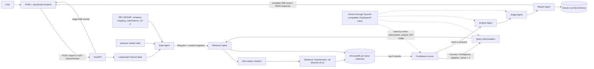
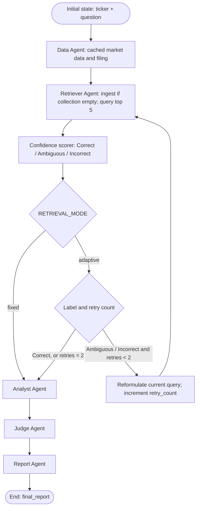
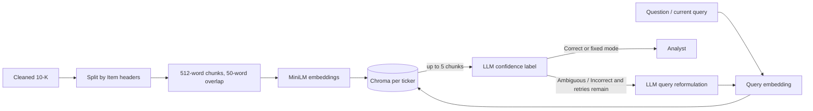

# Financial Research Analyst

<div align="center">

**An educational financial research application that investigates a company's latest SEC 10-K alongside market data.**

Five LangGraph nodes fetch data, retrieve filing evidence, draft an analysis, evaluate it, and format a report. Adaptive retrieval can reformulate a weak query before analysis.

[Architecture](#architecture) · [Retrieval](#retrieval-pipeline) · [Setup](#local-setup) · [API](#api)


</div>

## Contents

- [Overview](#overview)
- [Architecture](#architecture)
- [The five agents](#the-five-agents)
- [Retrieval pipeline](#retrieval-pipeline)
- [Judge and evaluation](#judge-and-evaluation)
- [API](#api)
- [Technology stack](#technology-stack)
- [Repository layout](#repository-layout)
- [Local setup](#local-setup)
- [Configuration](#configuration)
- [Performance and evaluation](#performance-and-evaluation)
- [Tests](#tests)
- [Screenshots](#screenshots)
- [Limitations](#limitations-and-trade-offs)
- [Engineering decisions](#engineering-decisions)
- [Roadmap](#future-work)
- [Responsible use](#responsible-use)
- [References](#references)

## Overview

Long annual filings are difficult to search manually. This project explores a graph-based workflow that retrieves passages from a company's latest 10-K, drafts a question-focused bull/bear analysis, and returns it with a separate market snapshot.

| Capability | Implementation |
|---|---|
| Filing research | Fetches the latest 10-K listed in SEC submissions data and extracts text for the selected ticker. |
| Market snapshot | Gets price, 52-week range, P/E, market capitalization, revenue, and EPS through `yfinance`; this data is separate from filing evidence. |
| Filing retrieval | Splits text into Item sections, embeds overlapping chunks, and searches a persistent per-ticker Chroma collection. |
| Adaptive retrieval | An LLM labels retrieved evidence Correct, Ambiguous, or Incorrect; adaptive mode can reformulate and retry up to two times. |
| Analysis and review | Analyst creates structured bull points, bear points, summary, and section citations. Judge scores grounding, completeness, and clarity. |
| User interface | FastAPI serves a browser UI and streams graph stage updates over Server-Sent Events (SSE). |
| Report history | SQLAlchemy persists reports and Judge scores in SQLite by default. |

The system is an engineering and learning project, not a production financial research service. “Grounded” means evaluated against retrieved filing chunks; it does not establish factual correctness or full filing coverage.

## Architecture



The graph state carries the ticker, original and current question, market and filing data, retrieved chunks, confidence label and retry count, analyst draft, Judge result, and final report. The five named agents are graph nodes; the confidence scorer is an additional node between retrieval and analysis. In fixed mode, the confidence call still runs, but its label does not trigger retries.

### LangGraph execution



The initial retrieval counts as attempt one. `retry_count` starts at zero and permits at most two additional retrieval passes. Once retry capacity is exhausted, the graph proceeds to the Analyst with the latest retrieved chunks—even if the confidence label remains weak. There is no alternate terminal path for a low score.

## The five agents

| Agent | Responsibility | Input | Output and downstream use |
|---|---|---|---|
| Data | Obtain the latest 10-K text and market snapshot. Uses a 24-hour JSON cache for market and filing responses. | Ticker | `filing_text`, `price_data`, `fundamentals` in graph state; the Retriever ingests filing text, while the Report includes market figures. |
| Retriever | Create a per-ticker Chroma collection when empty, then query the current question. | Filing text, ticker, current query | Up to five `{text, section, distance}` chunks; the scorer judges these and the Analyst uses them. |
| Analyst | Ask Gemini for a validated structured analysis constrained by financial data and retrieved chunks. Empty retrieval produces an insufficient-data summary without an LLM call. | `fundamentals`, retrieved chunks | `report_draft`: bull points, bear points, neutral summary, citations. |
| Judge | Score draft grounding, completeness, clarity, and overall quality against retrieved chunks. | Draft, retrieved chunks | `judge_score`, including flagged issues; persisted and returned for display. It does not approve, reject, or revise the report. |
| Report | Assemble market snapshot, bull/bear cases, summary, and retrieved sources into Markdown/HTML-like report text. | Market data, draft, chunks | `final_report`; API saves it to history. |

LangGraph passes partial state updates between nodes and routes conditionally after the confidence scorer. The agents are functions orchestrated in one graph, not independent services.

## Retrieval pipeline

1. **Acquire:** Data Agent maps an alphabetic ticker to a CIK using SEC's ticker mapping (with an XOM override), reads the submissions record, and fetches the latest listed `10-K` primary document. Market data comes separately from `yfinance`.
2. **Clean:** BeautifulSoup removes script, style, and table elements. The text cleanup drops blank lines and lines without spaces, which can also remove some legitimate fragments.
3. **Chunk and embed:** Text is split on headers matching `Item <number>[optional letter].`. Each section is chunked by 512 words with 50-word overlap. If fewer than ten chunks result, fixed-size chunks labeled `Item General` are used. `all-MiniLM-L6-v2` embeds each chunk.
4. **Index:** ChromaDB stores embeddings, chunk text, and section metadata in persistent collections named `ticker_<lowercase ticker>` under `./chroma_db`. A non-empty collection is reused without checking whether its filing is still current.
5. **Search:** The question (or a reformulated query) is embedded by the same model. Chroma cosine-distance search returns up to five nearest chunks. Optional `section_filter` exists in the vector-store function but is not used by the graph.
6. **Score and retry:** The Gemini-backed scorer grades evidence sufficiency. Adaptive mode retries for `Incorrect` or `Ambiguous`, reformulating the original question using previous chunks and scorer reasoning. Maximum: two retries. Fixed mode still scores but always proceeds directly.
7. **Analyze:** The latest retrieved chunks go to the Analyst, which returns structured claims and section names. They are not guaranteed to cover all relevant filing evidence.

| Mode | Behavior | Use case |
|---|---|---|
| `fixed` | One top-five retrieval; confidence scoring executes but never triggers another pass. | Predictable baseline and comparison runs. |
| `adaptive` | Up to two query-reformulation retries when the scorer returns Incorrect or Ambiguous. | Experimenting with retrieval recovery when the first result set appears insufficient. |



There is no keyword/dense hybrid search, reranker, or automatic best-of-N selection in the graph. Retrieval distances are returned with chunks but are not the confidence score: sufficiency is judged by an LLM.

## Judge and evaluation

The Judge receives only the structured Analyst draft and retrieved filing chunks. It asks for 0–10 grounding, completeness, clarity, and overall scores plus `flagged_issues`. Pydantic validates the API Judge response. If API evaluation fails, the score is set to `null`; the workflow continues to report generation. The final report does not include Judge scores in its text, but the API payload and history store them.

| Mode | Implementation | Requirements and status |
|---|---|---|
| `api` | Gemini via the shared OpenAI-compatible `ChatOpenAI` client; structured JSON parsing/validation. | Requires `GEMINI_API_KEY`; default mode. |
| `finetuned` | Loads the local adapter with Unsloth, 4-bit loading, 6,144-token context, and CUDA generation. | Needs the Unsloth/model stack and CUDA GPU. `unsloth` is not in `requirements.txt`. A local adapter directory is present, but the normal application path has not been verified as a supported CPU mode. |

The API and fine-tuned backend are selected using `JUDGE_MODE` at module import/startup. Although requests accept `judge_mode`, the request value is copied into graph state and saved as metadata; `judge_agent_node` does not read it. Thus a request asking for `finetuned` does not switch the backend unless the process starts with `JUDGE_MODE=finetuned`. The UI can display the requested mode, so it may not reflect the actual evaluator.

Scores are model judgments, not objective correctness metrics. The Judge cannot assess evidence that was not retrieved, and a market-data figure can be flagged as ungrounded because only filing chunks are supplied. Existing evaluation notes report score variation between runs and weak-to-moderate API/fine-tuned agreement; those measurements are experiments, not guarantees.

## API

The FastAPI app serves the frontend at `/` and exposes these routes:

| Method | Endpoint | Description |
|---|---|---|
| `POST` | `/report` | Run graph synchronously, persist result, return allowlisted UI fields. |
| `GET` | `/report/stream` | Stream graph node progress and final result as SSE; persist on completion. |
| `GET` | `/reports` | Return up to 20 reports, newest first. |
| `GET` | `/reports/{report_id}` | Return one persisted report or 404. |
| `GET` | `/health` | Check database; returns 200 with `{"status":"ok","database":true}` or 503 when unavailable. |

Both generation routes take a ticker and a 1–500 character question; `judge_mode` is optional and accepts `api` or `finetuned`. Tickers are trimmed, uppercased, and must contain letters only. Schema errors return 422; invalid ticker returns 400. Synchronous generation maps upstream timeouts to 504, provider/runtime errors to 502, and other errors to 500. Streaming failures are sent as an SSE `error` event (HTTP response may already have started).

`/report` request:

```bash
curl -X POST http://localhost:8000/report \
  -H 'Content-Type: application/json' \
  -d '{"ticker":"AAPL","question":"What are the main growth drivers and risks?","judge_mode":"api"}'
```

The JSON result includes `ticker`, `question`, `final_report`, `judge_score`, `price_data`, `fundamentals`, confidence label/reasoning, and `retry_count`. Raw filing text is intentionally not included.

Streaming request (SSE uses GET query parameters):

```bash
curl -N 'http://localhost:8000/report/stream?ticker=AAPL&question=What%20are%20the%20main%20growth%20drivers%20and%20risks%3F&judge_mode=api'
```

| Event | Payload |
|---|---|
| `stage` | JSON with a `stage` value (initially `data`, then a graph node name) and a `message`; emitted initially and as nodes complete. |
| `complete` | Same UI result fields as `/report`, after persistence. |
| `error` | `{ "message": "An error occurred while generating the research report. Please try again." }`. |

The browser uses `EventSource` for this streaming endpoint. The frontend is mounted by FastAPI, so opening `http://localhost:8000/` is the simplest supported local path.

## Technology stack

| Category | Technology | Role |
|---|---|---|
| Language and validation | Python 3.12, Pydantic 2 | Application, schemas, and structured model output validation. |
| Orchestration | LangGraph, LangChain | Stateful graph and LLM integration. |
| LLM | Gemini API via `langchain-openai` `ChatOpenAI` compatibility endpoint | Query reformulation, confidence scoring, analysis, and API Judge. |
| Embeddings | Sentence Transformers `all-MiniLM-L6-v2` | Local chunk and query embeddings. |
| Vector store | ChromaDB persistent client | Per-ticker embedding index and nearest-neighbor search. |
| Data sources | SEC EDGAR, `yfinance` | 10-K filing text and separate market/fundamental data. |
| Backend and streaming | FastAPI, Uvicorn, SSE | HTTP endpoints, event stream, static frontend serving. |
| Frontend | HTML, CSS, JavaScript, Marked | Research form, progress, report display, history. |
| Persistence | SQLAlchemy, SQLite by default | Saved reports and Judge scores. |
| Evaluation | pytest, RAGAS, datasets, Matplotlib | Unit/integration checks and offline research/evaluation scripts. |
| Optional observability | LangSmith tracing variables | Optional LangChain tracing when configured. |
| Optional Judge | Unsloth adapter inference | Fine-tuned Judge path; extra GPU/model dependencies are not in the base requirements. |

## Repository layout

```text
agents/       Five agent nodes, graph, prompts, shared LLM client
app/          FastAPI application and request schemas
data/         SEC EDGAR, market data, and 24-hour JSON cache
retrieval/    Filing chunking, embeddings, Chroma store, confidence scorer
db/           SQLAlchemy models, database setup, persistence, health check
frontend/     Single-page HTML/CSS/JavaScript interface
tests/        Unit tests and opt-in live end-to-end test
scripts/      Timing benchmark and adaptive-retrieval experiment
eval/         Retrieval, Judge, and RAGAS evaluation scripts
docs/         Architecture, retrieval design, rubric, and baseline notes
finetune/     Judge datasets and local adapter artifact
results/      Recorded evaluation JSON and charts
outputs/      Sample generated report outputs
Dockerfile    Container image definition
docker-compose.yml  Container service and persistent SQLite volume
requirements.txt    Application and evaluation dependencies
requirements-dev.txt  pytest and Ruff
```

## Local setup

### Prerequisites

- Python 3.12 (the Docker image uses Python 3.12).
- A Gemini API key for generation, scoring, and adaptive query reformulation.
- Network access on first startup to download the Sentence Transformer model, and at runtime for SEC, market data, and Gemini requests.

Clone and install from the repository root:

```bash
git clone https://github.com/Ayushcv-46/fin-research-agent.git
cd fin-research-agent
python -m venv .venv
```

Activate and install (PowerShell shown first):

```powershell
.venv\Scripts\Activate.ps1
python -m pip install -r requirements.txt -r requirements-dev.txt
Copy-Item .env.example .env
```

```bash
# Linux / macOS / WSL
source .venv/bin/activate
python -m pip install -r requirements.txt -r requirements-dev.txt
cp .env.example .env
```

Edit `.env` and set `GEMINI_API_KEY`. From the project root, start the app:

```bash
python -m uvicorn app.main:app --host 127.0.0.1 --port 8000
```

On startup FastAPI warms the embedding model; the first run may download it. SQLAlchemy creates the SQLite tables during import. Open **http://localhost:8000/**. The frontend is served by FastAPI; no separate frontend server or `PYTHONPATH` setting is required when started from the repository root.

To run with Docker Compose, create `.env` first, then:

```bash
docker compose up --build
```

The container exposes port 8000 and stores SQLite data in a named Docker volume. Chroma uses `./chroma_db` in the container filesystem and is not mounted as a persistent volume by the supplied Compose file.

## Configuration

`agents/llm_client.py`, `agents/graph.py`, and `agents/judge_agent.py` load `.env`; the Judge mode is captured when its module is imported. Set startup configuration before launching Uvicorn and restart after changing it.

| Variable | Purpose | Required | Default / behavior |
|---|---|---:|---|
| `GEMINI_API_KEY` | Gemini API credential used by the shared LLM client. | Yes | No default; missing key raises at import. Tests set a dummy fallback in `tests/conftest.py`. |
| `GEMINI_MODEL` | Model name passed to the Gemini OpenAI-compatible endpoint. | No | `gemini-3.5-flash-lite` |
| `RETRIEVAL_MODE` | Conditional routing after confidence scoring. | No | `adaptive`; `fixed` disables retries. Read during routing, so set in process environment. |
| `JUDGE_MODE` | Selects API or fine-tuned Judge backend at module import. | No | `api`; accepted values in code are effectively `api` or `finetuned` (other strings fall back to API). |
| `FINETUNED_ADAPTER_PATH` | Local adapter/model path for Unsloth loading. | Only for fine-tuned Judge | `finetune/full_adapter_v1` |
| `DATABASE_URL` | SQLAlchemy database URL. | No | Overrides SQLite path when set. Compose sets `sqlite:////app/data_storage/app.db`. |
| `SQLITE_DB_PATH` | SQLite file path used if `DATABASE_URL` is unset. | No | `./data/app.db` |
| `LANGCHAIN_TRACING_V2` | LangSmith/LangChain tracing switch. | No | `.env.example` sets `false`; tracing is controlled by LangChain. |
| `LANGCHAIN_API_KEY` | Credential for LangSmith tracing. | No | Unset unless configured. |
| `LANGCHAIN_PROJECT` | LangSmith project label. | No | `.env.example` uses `fin-research-agent`. |
| `SKIP_JUDGE` | Experiment switch that returns a zero-valued placeholder Judge result. | No | `false`; use only for experiments. |

`judge_mode` in the request schema is validated, but currently does not control the Judge backend. It is stored as report metadata; `JUDGE_MODE` controls actual backend selection at startup. `retrieval_mode` and `judge_mode` may be absent from graph state unless explicitly passed; generation routes do not set a retrieval mode field, even though routing reads `RETRIEVAL_MODE` from the environment.

## Performance and evaluation

The repository's `scripts/benchmark_timing.py` deletes the ticker's Chroma collection for the cold pass, then runs the same ticker warm. It times graph nodes and total graph duration. The script does not time model download/startup because the server lifespan is not invoked by direct graph construction; first embedding model load may therefore affect a run depending on cache state. SEC/market fetches, embedding/indexing on cold ingestion, model calls, and retries contribute to runtime.

| Observation in repository | Conditions and caveats |
|---|---|
| Warm fixed-mode runs: **7.6–12.3 s over six runs** | Existing README notes: laptop under WSL, Gemini `gemini-3.5-flash-lite`, ticker filing already ingested. The raw six-run log is not present, so treat as a recorded note rather than independently reproducible measurement. |
| Cold AAPL ingestion: **about 270–300 s** | Existing README note for `scripts/benchmark_timing.py`; “cold” deletes the AAPL Chroma collection, so SEC fetch, cleaning, chunk embedding/indexing, retrieval, and remaining graph work run. No raw timing log is checked in. |
| API Judge: **7.82 s average**; fine-tuned Judge: **11.81 s average** | `results/benchmark.json`: 12 samples each, Colab T4 per `results/RESULTS_SUMMARY.md`. Cost values are rough prompt-token estimates, not measured billing; the fine-tuned path reported $0 estimated per-call API cost. |
| Fixed/adaptive answer relevancy: **0.743 / 0.728** | `results/retrieval_comparison.json`, 12 tickers; only 3 faithfulness values were scoreable. This experiment did not show a meaningful adaptive improvement and is not a broad quality guarantee. |

Run the per-node timing script from the repository root with `.env` configured:

```bash
python scripts/benchmark_timing.py
```

Recorded timings depend on network/provider latency, cached data and embeddings, hardware, model configuration, and filing size. They are not service-level guarantees.

## Tests

Install `requirements-dev.txt` and run the default suite from the project root:

```bash
pytest -q
```

`pytest.ini` sets the project root on the import path and excludes tests marked `live` by default. To run one test module:

```bash
pytest -q tests/test_retriever_loop.py
```

Live tests call external services and require network access and working SEC/market/API configuration. Run explicitly with:

```bash
pytest -m live -q
```

Most unit tests mock network and model calls. The live end-to-end test exercises one AAPL run; it does not measure broad ticker coverage or output correctness. The repository does not document a coverage target.

## Screenshots

There are no application screenshots or demo GIFs in the repository. Add genuine captures here when available; the tracked charts under `results/charts/` are evaluation plots, not UI screenshots.

## Limitations and trade-offs

- Cold ticker ingestion can be slow; the recorded AAPL note is approximately 270–300 seconds.
- Chroma collections are reused once populated and are not refreshed when SEC posts a newer filing.
- The SEC text cleaner drops tables and no-space lines; Item-header chunking can miss section boundaries, while the fallback labels chunks generically.
- The Judge sees retrieved filing chunks only. It may flag market values as unsupported, cannot verify omitted filing passages, and can itself be inconsistent or wrong.
- Analyst output depends on retrieval quality. After two unsuccessful adaptive retries the workflow still generates a report from the latest result set.
- The request's `judge_mode` field does not switch the running backend; use startup `JUDGE_MODE` and restart. UI labeling may therefore misstate which backend ran.
- Fine-tuned inference requires CUDA and Unsloth, absent from base requirements; the checked-in adapter should not be taken as evidence of a verified deployment path.
- Ticker validation accepts alphabetic characters only, excluding symbols such as `BRK.B` and many non-US formats.
- Market data is supplied separately and can be missing or stale; the report does not attach source timestamps to each quote.
- The SSE route reports generic errors to clients; the synchronous route has more specific HTTP error mapping.

## Engineering decisions

- **Graph nodes with shared typed state:** makes stage boundaries and the retrieval conditional edge explicit and testable.
- **Fixed and adaptive retrieval modes:** supports a simple baseline alongside an LLM-directed retry experiment.
- **Persistent per-ticker embeddings plus cached upstream data:** avoids repeating filing preparation and network calls on every warm query, with a freshness trade-off for the vector collection.
- **SSE for long operations:** lets the browser show graph-stage progress without waiting for the final report; graph output is accumulated once during streaming and then persisted.
- **Separate API and adapter Judge implementations:** enables an experimental comparison behind one scoring schema, while request-vs-startup mode selection remains a known gap.
- **SQLite report history:** keeps local setup simple and provides a basic retrieval history for the UI.

## Future work

- Add filing-date/version metadata and refresh stale ticker collections.
- Improve section-aware extraction and evidence-level citations with links to filing locations.
- Evaluate retrieval with more reliable, repeatable measures and calibrate confidence decisions.
- Ground or label market data with provider and observation timestamps.
- Make Judge selection request-scoped and improve evaluation reliability.
- Move slow ingestion into background jobs and add operational latency/error monitoring.
- Broaden ticker, filing type, and international-market support.

## Responsible use

This project is an educational and engineering demonstration of AI-assisted financial research. It is not a registered financial advisor, does not provide personalized investment advice, and should not be used as the sole basis for investment decisions.

Independently verify financial figures, filing references, and conclusions. LLM-generated reports and Judge scores can contain errors, omissions, and unsupported claims.

## References

- [LangGraph documentation](https://docs.langchain.com/oss/python/langgraph/overview)
- [FastAPI documentation](https://fastapi.tiangolo.com/)
- [SEC EDGAR company submissions API](https://www.sec.gov/edgar/sec-api-documentation)
- [Gemini API documentation](https://ai.google.dev/gemini-api/docs)
- [Chroma documentation](https://docs.trychroma.com/)
- [Sentence Transformers documentation](https://www.sbert.net/)
- [LangSmith tracing documentation](https://docs.smith.langchain.com/)
- [MDN: Server-sent events](https://developer.mozilla.org/en-US/docs/Web/API/Server-sent_events)
